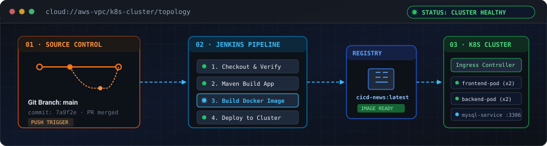
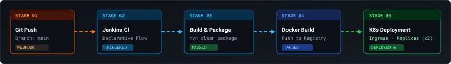
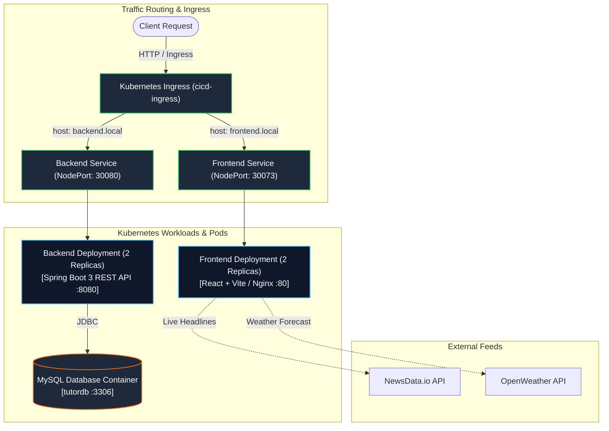
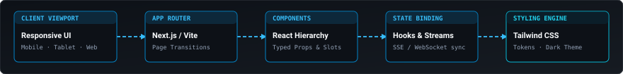
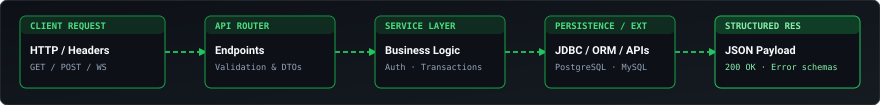
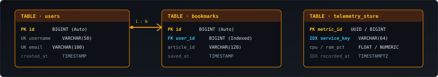
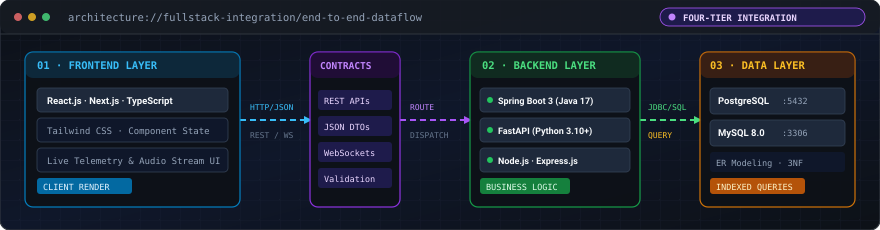

# <div align="center">Hi, I'm Bhanuteja Nallamothu 👋</div>

<div align="center">

[](https://git.io/typing-svg)

[](https://www.linkedin.com/in/bhanuteja-nallamothu-4b8677315/)
[](https://ik.imagekit.io/bhanuteja110/Nallamothu_Bhanuteja.pdf)
[](mailto:nallamothubhanuteja110@gmail.com)
[](https://maps.google.com)

</div>

---

### ⚡ Architectural Philosophy

> *"Software engineering is most powerful when robust cloud infrastructure, clean application design, and intelligent machine learning models operate in seamless harmony."*

I am an engineer focused on the intersection of **Cloud-Native Infrastructure**, **Resilient Full-Stack Systems**, and **Applied Artificial Intelligence**. From orchestrating Kubernetes clusters and zero-trust CI/CD pipelines to engineering high-concurrency streaming platforms and deploying computer vision microservices, I design and build production-ready systems that scale reliably.

---

## 01 — DevOps & Cloud Engineering

<div align="center">



</div>

I design and operate automated deployment systems, cloud-native container workloads, and declarative delivery pipelines with a focus on reproducibility, isolated container environments, and structured infrastructure topologies.

### 🛠️ Infrastructure Toolset

| Domain | Technologies | Architectural Responsibility |
| :--- | :--- | :--- |
| **Source Control** |   | Feature branch workflows, pull request automation, and webhook commit triggers |
| **CI/CD** |  | Declarative pipeline orchestration, automated artifact packaging, and build staging |
| **Containers & Orchestration** |   | Multi-stage image compilation, Pod replica controllers, and NodePort service networking |
| **Cloud & IaC** |   | Cloud infrastructure provisioning, VPC networking, and declarative state definitions |
| **Security & Policy** |   | Container vulnerability auditing, Kubernetes admission control, and policy enforcement |
| **Operating System** |  | Shell automation, service configuration, and container host administration |

### 🔄 Automated CI/CD Delivery Pipeline

```text
[ Git Push ] ──► [ Jenkins CI ] ──► [ Maven Build ] ──► [ Docker Image ] ──► [ K8s Deployment ]
  main branch      Webhook trigger     mvn package        Registry push        2x Pod Replicas
```

<div align="center">



</div>

- **Source Trigger**: Code committed to `main` branch fires a webhook trigger to the CI controller.
- **Pipeline Execution**: Jenkins pipeline allocates an agent and stages the workspace repository.
- **Artifact Compilation**: Automated application build and packaging via Maven (`mvn clean package`).
- **Container Build**: Docker compiles the service layer, tags `bhanuteja110/cicd-news-backend:latest`, and pushes to the Docker registry with credentials.
- **Cluster Deployment**: Workload is rolled out to Kubernetes with configured replica sets and active healthchecks.

### 🚀 Featured Project: CI/CD News Platform

*An enterprise multi-tier news and weather dashboard engineered to demonstrate continuous integration pipelines, containerized service coordination, and Kubernetes traffic management.*

[](https://github.com/Bhanutejanallamothu/cicd-news)
[](https://github.com/Bhanutejanallamothu/cicd-news)
[](https://github.com/Bhanutejanallamothu/cicd-news)
[](https://github.com/Bhanutejanallamothu/cicd-news)

#### Architecture & Deployment Flow


#### Verified Implementation Details
- **Multi-Service Containerization**: Orchestrates a React/Vite client, Spring Boot 3 backend service, and MySQL database container connected via a Docker bridge network with persistent volume storage.
- **Declarative Jenkins Pipeline**: Implements scripted stages in `Jenkinsfile` handling repository checkout, Maven build compilation, container image tagging, Docker Hub registry push, and target deployment execution.
- **Kubernetes Workload Manifests**:
  - `cicd-frontend-service`: Configured as a NodePort service (`nodePort: 30073`) managing 2 replica pods on port `80`.
  - `cicd-backend-service`: Configured as a NodePort service (`nodePort: 30080`) routing traffic to 2 Spring Boot replica pods on port `8080`.
  - `cicd-ingress`: Path-based Ingress controller rule routing `frontend.local` to frontend pods and `backend.local` to backend API endpoints.
- **Health Check & Startup Coordination**: Configured with Hikari connection timeouts and container startup delay handling for smooth database initialization.

---

## 02 — Software & Full-Stack Development

From user interface engineering to transactional persistence, I architect multi-tier software systems built on type safety, clean separation of concerns, and resilient data contracts across the entire application lifecycle.

### 01 / Frontend Engineering
*User interfaces · Responsive layouts · Component architecture · Client-side state · API integration*

<p align="left">
  
  
  
  
  
  
</p>

<div align="center">



</div>

- **Component-Based UI Architecture**: Building reusable, modular interface hierarchies with React and Next.js, emphasizing clean prop interfaces, composability, and predictable state transitions.
- **Responsive Layout Design**: Crafting responsive web layouts using Tailwind CSS utility systems that adapt smoothly across mobile, tablet, and desktop form factors.
- **API & Stream Integration**: Binding user interfaces to backend services using asynchronous fetch lifecycles, RESTful JSON consumption, and real-time Server-Sent Events (SSE) / WebSockets.
- **Live Data & Analytics Presentation**: Presenting live operational metrics, audio streaming controls, and search filters with intuitive visual feedback and loading states.

---

### 02 / Backend Engineering
*Business logic · API endpoints · Validation · Authentication · Service integration*

<p align="left">
  
  
  
  
  
  
</p>

<div align="center">



</div>

- **RESTful API Design & Routing**: Structuring modular controller and router layers across Spring Boot, FastAPI, and Express with standard HTTP verbs, clean route parameters, and consistent JSON payload envelopes.
- **Request Validation & Error Handling**: Implementing schema validation (Pydantic in FastAPI, Bean Validation in Spring Boot) and centralized error handlers returning normalized error responses.
- **Asynchronous Processing**: Leveraging non-blocking coroutines in FastAPI for high-throughput metric ingestion and event-driven patterns in Node.js for low-latency request queuing.
- **Multi-Service Coordination**: Integrating backend services with relational databases, container networks, and external third-party streaming/weather endpoints.

---

### 03 / Database Engineering
*Relational modeling · Normalization · Indexing · Joins · Query optimization*

<p align="left">
  
  
  
</p>

<div align="center">



*Illustrative relational schema depicting entity keys, foreign constraints, and indexing patterns.*

</div>

- **Relational Data Modeling & Normalization**: Designing structured third normal form (3NF) schemas with primary key constraints, foreign key cascades, and unique column integrity.
- **Index Optimization & Query Tuning**: Implementing single-column and composite B-tree indexes on high-frequency filter keys (`user_id`, `service_key`, `recorded_at`) to prevent table scans.
- **Relational Joins & Data Aggregation**: Writing multi-table joins, grouped aggregations, and filtered queries across relational tables to supply client dashboards efficiently.
- **Connection Pooling & Lifecycle**: Configuring database connection pools and connection timeouts (HikariCP in Spring Boot, async engine pools in FastAPI/Node) for stable resource utilization.

---

### 04 / Full-Stack Architecture & Integration
*Frontend + Backend + Database + Container Runtime connected as one cohesive application*

<div align="center">



</div>

#### Featured Full-Stack Projects

##### 1. PulseBoard AI — Real-Time Telemetry & Observability Engine
*An intelligent operational telemetry platform monitoring system heartbeats and detecting metric anomalies.*

[](https://github.com/Bhanutejanallamothu/Pulseboard.AI)
[](https://github.com/Bhanutejanallamothu/Pulseboard.AI)
[](https://github.com/Bhanutejanallamothu/Pulseboard.AI)
[](https://github.com/Bhanutejanallamothu/Pulseboard.AI)
[](https://github.com/Bhanutejanallamothu/Pulseboard.AI)

- **Asynchronous Telemetry Ingestion**: Python FastAPI backend accepting high-frequency node heartbeats and hardware telemetry via `/api/telemetry` without blocking incoming requests.
- **Structured Metric Storage**: PostgreSQL database persistence capturing timeseries records for CPU, memory, and service latency data points.
- **Anomaly Detection Service**: Pandas and Scikit-learn trend scoring models evaluating telemetry variance to flag threshold deviations.
- **Live Observability Interface**: React 18 / TypeScript frontend presenting interactive telemetry cards and real-time dashboard updates.

##### 2. KL Radio — Campus Live Broadcasting Portal
*A campus live streaming web platform connecting listeners, student song requests, and studio broadcasters.*

[](https://www.klradio.in/)
[](https://github.com/Bhanutejanallamothu/Klradio)
[](https://github.com/Bhanutejanallamothu/Klradio)
[](https://github.com/Bhanutejanallamothu/Klradio)
[](https://github.com/Bhanutejanallamothu/Klradio)
[](https://github.com/Bhanutejanallamothu/Klradio)

- **Reactive Web Player**: Next.js 15 and Tailwind CSS client providing real-time audio playback controls, show schedule timetables, and student song request forms.
- **Request Queue Service**: Express.js REST API facilitating student song submissions, RJ studio moderation workflows, and request upvoting.
- **Audio Signaling Microservice**: FastAPI service coordinating low-latency WebRTC streaming audio sessions for live broadcasts.
- **Relational Data Management**: PostgreSQL database managing relational tables for scheduled programs, broadcast archives, and verified student requests.

##### 3. CI/CD News Platform — Multi-Tier Aggregator
*An enterprise multi-container news and weather aggregation portal demonstrating layered service integration.*

[](https://github.com/Bhanutejanallamothu/cicd-news)
[](https://github.com/Bhanutejanallamothu/cicd-news)
[](https://github.com/Bhanutejanallamothu/cicd-news)
[](https://github.com/Bhanutejanallamothu/cicd-news)
[](https://github.com/Bhanutejanallamothu/cicd-news)

- **Client Aggregation Interface**: React (Vite) frontend rendering live category news feeds from NewsData.io alongside localized weather telemetry from OpenWeather API.
- **Enterprise Spring Boot Backend**: Java 17 service managing user authentication endpoints and personal article bookmarking logic.
- **Containerized Database**: MySQL 8.0 relational persistence layer with isolated container networking and persistent storage volumes.
- **Coordinated Kubernetes Deployment**: Exposed via NodePort services with unified Ingress path routing for client and backend services.

---

## 03 — Artificial Intelligence & Machine Learning

I specialize in applying computer vision, surrogate modeling, and dataset engineering to solve real-world engineering problems and deliver production-grade ML inference APIs.

### 🛠️ AI/ML Toolset & Libraries
<p align="left">
  
  
  
  
  
  
  
</p>

### 🚀 Featured Project: AutoTune.ai — Vehicle Intelligence Microservice
*A high-performance vehicle intelligence and zero-trust ML microservice pairing deep learning computer vision with predictive calibration optimization.*

[](https://github.com/Bhanutejanallamothu/auto)
[](https://github.com/Bhanutejanallamothu/auto)
[](https://github.com/Bhanutejanallamothu/auto)

- **Computer Vision Part Identification**: Custom-trained YOLOv8 inference endpoint (`/identify-part`) providing real-time visual part localization and multi-class classification.
- **Surrogate Engine Optimization**: Machine learning surrogate model trained with XGBoost (`/ecu/score`) that evaluates engine calibration states and proposes bounded adjustment deltas (`/ecu/recommend`).
- **Automated Root-Cause Diagnostics**: Failure reasoning engine (`/diagnose`) coordinating telemetry triage with automated diagnostic handoffs.
- **Production Hardening**: Enclosed in hardened non-root container images with startup, liveness, and readiness probes alongside Prometheus latency instrumentation (`/metrics`).

### 🔬 Applied AI, Audio Processing & Dataset Preparation
- **Swecha Open-Source AI Initiative**: Curated, preprocessed, and tokenized large-scale Telugu language text corpora, fine-tuning NLP models and achieving a **10% increase in model accuracy**.
- **Audio Signal Processing**: Implemented audio analysis pipelines utilizing STFT and spectral domain representations for broadcast signal monitoring and acoustic anomaly profiling.
- **Vision Recognition Systems**: Designed and evaluated custom object detection models for sign detection and visual tracking pipelines.

---

## 04 — Experience, Achievements & GitHub Activity

### 💼 Engineering Experience & Leadership

```text
2024 ───► KL Radio (Technical Lead)
           ├─ Led 15-member engineering and production team
           ├─ Architected full-stack live streaming infrastructure (99.9% uptime)
           └─ Delivered 50+ live broadcasts for 500+ concurrent listeners
2025 ───► Swecha (Technology Intern)
           ├─ Improved Telugu NLP model accuracy by 10%
           ├─ Boosted frontend load performance by 18% via bundle splitting
           └─ Collaborated on large-scale open-source Telugu language datasets
2025 ───► AICTE EduSkills (Software Developer Intern)
           ├─ Designed scalable RESTful APIs and token-based auth workflows
           └─ Optimized PostgreSQL queries and database indexing
```

### 🏆 Certifications & Recognitions
- 📜 **Oracle AI Foundations Associate** — Oracle University (AI/ML Fundamentals, Deep Learning, Generative AI)
- ⚡ **HackerRank SQL Certification** — Advanced Database Query Design, Joins, and Performance Tuning
- 🛠️ **HackerRank C Certification** — Systems Programming & Memory Management
- 🌐 **Cambridge Linguaskill** — International Professional Communication
- 🎙️ **Core Technical Member, Radio Fiesta** — Spearheaded university broadcast network and live audio coordination

---

### 📊 GitHub Activity & Statistics

<div align="center">


<br/>


<br/>


</div>

---

### 📬 Connect & Collaborate

<div align="center">

[](https://www.linkedin.com/in/bhanuteja-nallamothu-4b8677315/)
[](https://ik.imagekit.io/bhanuteja110/Nallamothu_Bhanuteja.pdf)
[](mailto:nallamothubhanuteja110@gmail.com)
[](https://github.com/Bhanutejanallamothu)

<br/>

<sub>Designed and maintained by <b>Bhanuteja Nallamothu</b> • Updated October 2026</sub>

</div>
